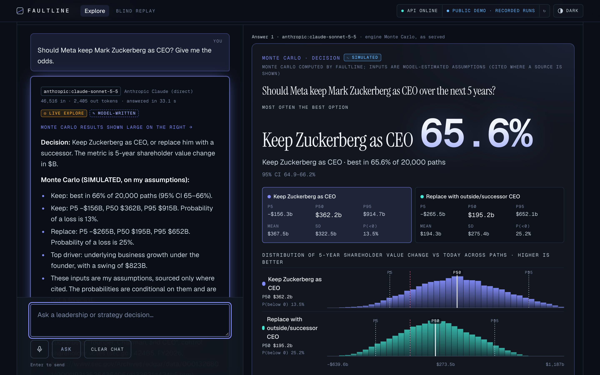
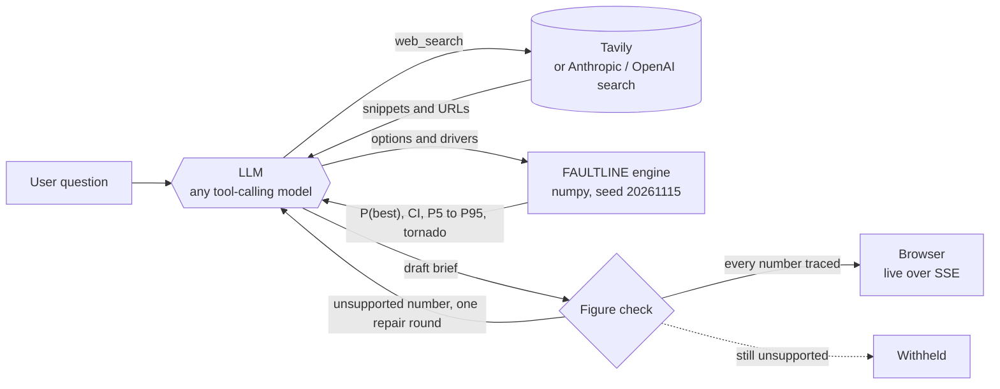
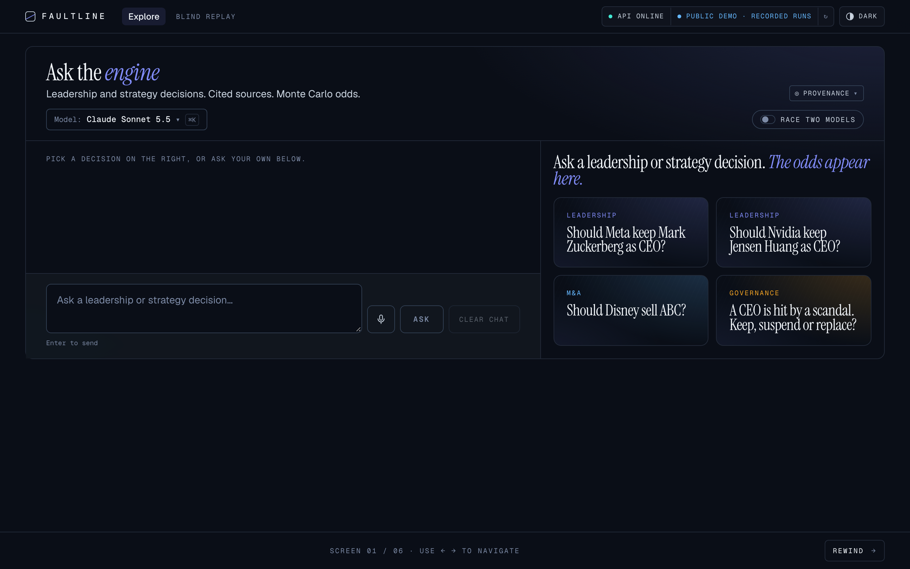
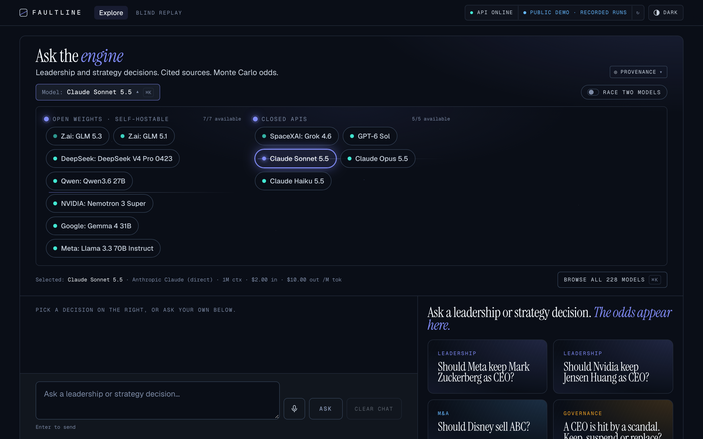

<p align="center">
  
</p>

<h1 align="center">FAULTLINE</h1>
<p align="center">By <strong>Ashsmith Khayrul</strong> &amp; <strong>Yaseen Ahmad</strong> · 300 AI Hackathon (Northeastern × SCION), Boston</p>

<p align="center">
  Test the decision before you live with it. Ask FAULTLINE a leadership or strategy question, such as whether a company should keep its CEO. A language model searches the web and turns the question into options and uncertain drivers, with sources. Then a seeded Python engine, not the model, runs 20,000 Monte Carlo paths and computes the odds. The model writes the brief around those numbers, and a server-side check withholds any reply that contains a figure the engine or a cited source didn't produce.
</p>

<p align="center">
  <a href="https://faultline.khayrul.com">
    
  </a>
  
</p>

<p align="center">
  
  
  
</p>

<p align="center">
  
  
  
  
  
</p>

<p align="center">
  <a href="#the-problem">The problem</a> ·
  <a href="#how-it-works">How it works</a> ·
  <a href="#results">Results</a> ·
  <a href="#how-it-keeps-the-ai-honest">Honesty</a> ·
  <a href="#sponsors">Sponsors</a> ·
  <a href="#run-it-yourself">Run it yourself</a>
</p>

<p align="center">
  
</p>
<p align="center">
  <sub>A live answer on faultline.khayrul.com, Nov 15, 2026, on Claude Sonnet 5.5 (answered in 33.1 s). The model estimated the inputs; FAULTLINE's engine computed every number on the right: keeping Zuckerberg comes out best in 65.6% of 20,000 paths (95% CI 64.9-66.2%). P5 / P50 / P95 of the 5-year shareholder value change are -$156.3B / $362.2B / $914.7B for keep and -$265.5B / $195.2B / $652.1B for replace. These are SIMULATED odds, conditional on the model's assumptions. They are not a forecast.</sub>
</p>

---

## The problem

Leadership decisions are argued in words. "Keep the founder or bring in an outside CEO?" "Sell the division?" "Ride out the scandal or replace the CEO?" The arguments are usually good, but nobody can say how likely each outcome is, which assumption the answer hinges on, or how bad the bad case gets.

A chatbot will happily answer anyway, with confident percentages it made up. Language models are good at research and at framing a question. They are bad at arithmetic and worse at admitting when they have no data. Put a language model in a decision tool and it ends up inventing the numbers people act on.

FAULTLINE splits the work. The model does what it's good at: searching, reading, and turning a question into options and drivers, with sources. Typed Python does every calculation, with a fixed seed and a hash of its inputs, so the same question gives the same odds every time. Every figure on screen carries a label saying where it came from, and anything the model can't back up is withheld.

## How it works

1. **Ask.** The user types a leadership or strategy decision, or picks a starter question.
2. **Research.** The model searches the web, with follow-up searches when the first results leave gaps. The search backend is Tavily when its key is set, otherwise Anthropic's server-side web search, otherwise OpenAI web search, and a failed Anthropic search gets one retry on OpenAI.
3. **Model the decision.** The model builds a decision model: two to four options, each with uncertain drivers (a range, a distribution, and for events a probability), citing a source wherever it has one.
4. **Simulate.** FAULTLINE's Python engine (numpy, seed `20261115`, SHA-256 of the canonical input) runs 20,000 Monte Carlo paths. For each option it reports the probability of being best with a Wilson 95% CI, P5 / P25 / P50 / P75 / P95, the probability of a loss, and a tornado sensitivity showing which driver moves the answer most.
5. **Write the brief.** The model writes the answer around the engine's numbers, and states that its inputs are assumptions.
6. **Check every figure.** Before anything is shown, the server checks every number in the reply against the tool results and the cited snippets. If a number isn't found there, the model gets one automatic repair round, and if the number is still unsupported the reply is withheld.
7. **Stream.** Each step (searches, the simulation, the check) streams to the browser live over server-sent events.



<p align="center">
  
</p>
<p align="center">
  <sub>The Explore screen: pick a starter decision or ask your own. The model selector and "Race two models" sit at the top.</sub>
</p>

<p align="center">
  
</p>
<p align="center">
  <sub>The model picker as served tonight: seven open-weight models flagged self-hostable, five closed APIs, and 228 models in the full catalog. The engine and the figure check are the same whichever model answers.</sub>
</p>

**Any model.** The chat runs on any tool-calling model in the OpenRouter catalog (228 listed when the screenshot above was taken), plus the native Anthropic and OpenAI APIs. The featured open-weight models are flagged self-hostable: GLM-5.3, GLM-5.1, DeepSeek V4 Pro, Qwen3.6-27B, Nemotron 3 Super, Gemma 4 31B, Llama 3.3 70B and Qwen3-235B (each appears when it's in the live catalog). The featured closed models are Claude Sonnet 5.5 (the default), Claude Opus 5.5, GPT-6 Sol, Grok 4.6 and Claude Haiku 5.5. "Race two models" runs one question on two models side by side.

**Hypotheticals.** A premise about a real person that the sources don't support ("Jensen Huang had 3 affairs...") is answered as a labelled, unverified hypothetical. It is never presented as fact.

---

## Results

Everything below was measured on this codebase. None of it is a claim about forecast accuracy.

### The headline answer

| | Keep Zuckerberg as CEO | Replace with outside/successor CEO |
|---|---|---|
| Best option in (of 20,000 paths) | **65.6%** (95% CI 64.9-66.2%) | |
| P5 | -$156.3B | -$265.5B |
| P50 | **$362.2B** | $195.2B |
| P95 | $914.7B | $652.1B |
| P(below 0) | 13.5% | 25.2% |

Metric: 5-year shareholder value change, in $B, from the model's own estimated drivers. Model: Claude Sonnet 5.5; total time to the full answer, including web research: 33.1 s. Label: SIMULATED. These odds are only as good as the model's assumptions. The table shows what follows from those assumptions; it is not a prediction of what Meta will do or what will happen.

### The engine

| | |
|---|---|
| Decision Monte Carlo, 20,000 paths | **~18 ms** |
| Cash-flow Monte Carlo, 10,000 paths | **~100-300 ms** |
| Same request, same seed | same output, byte for byte (except `runtime_ms`) |
| Backend tests passing (`make test`) | **2,775** (6 skipped) |

### The demo business

The second engine stress-tests a SYNTHETIC business: a fictional three-store grocer with a weekly cash recurrence and a SciPy MILP recovery optimizer. "Protect payroll" is a hard constraint in the solver (payroll cut ≤ 0), not a prompt, and when no plan keeps cash above the floor the optimizer says **NO FEASIBLE PLAN**. On the "bad quarter" scenario (rates up two points, demand down a fifth, main supplier out three weeks), the cash Monte Carlo gives:

| 10,000 paths, seed 20261115 | P(cash breaches the $25,000 floor) |
|---|---|
| No plan | **91.0%** (95% CI 90.5-91.6%) |
| With the optimizer's plan | **70.1%** (95% CI 69.2-71.0%) |

The plan still breaches the floor on many paths, and that is expected: the optimizer finds the least disruptive plan that keeps the central scenario at or above the floor, and that plan's lowest cash is exactly $25,000. Any path that turns out worse than the centre dips below it. The spreads are ±50% ILLUSTRATIVE assumptions awaiting the finance owner's review ([docs/MATH_MODEL.md](docs/MATH_MODEL.md) §11.2).

### Blind Replay

Blind Replay is the honesty proof. It rewinds to 28 real, already-resolved events (15 FOMC rate decisions and 13 US CPI prints, [docs/CASES.md](docs/CASES.md)), gives the model only evidence that was public at the cutoff (`available_at <= as_of`), and saves each forecast with hashes **before** the sealed outcome is revealed. The scorecard compares the model with the prediction market and a naive baseline. With fewer than 5 cases it says INSUFFICIENT DATA, and it reports a difference only when a bootstrap CI excludes zero. No official scored run exists yet, so this README makes no accuracy claim. The protocol is in [docs/EVALUATION_PROTOCOL.md](docs/EVALUATION_PROTOCOL.md).

---

## How it keeps the AI honest

The full one-pager for judges is [docs/ALIGNMENT.md](docs/ALIGNMENT.md).

- **The model never does the arithmetic.** Odds, quantiles, cash flows and plans come from typed Python and the optimizer. The model proposes inputs.
- **Withheld, not invented.** A reply with a number that isn't in a tool result or a cited snippet gets one repair round and is otherwise withheld. Missing data shows as NOT AVAILABLE.
- **Everything is labelled.** Every displayed number carries a provenance label: REAL HISTORICAL, SYNTHETIC, RECORDED RUN, SIMULATED, ILLUSTRATIVE, LIVE EXPLORE or MODEL-WRITTEN.
- **Values are constraints.** Protect payroll is a hard bound in the MILP, so no prompt can talk the solver into a pay cut.
- **Humans decide.** FAULTLINE proposes and evaluates. It has no integration that moves money, trades, lends or changes anyone's job.
- **The future stays sealed.** Replay evidence passes a point-in-time gate, sealed outcomes are read only after the forecast is saved, and the replay code never touches live web search.

## Sponsors

### Anthropic

Claude Sonnet 5.5 is the default model in the chat, with Opus 5.5 and Haiku 5.5 also featured, through the native Anthropic API. Anthropic's server-side web search is next in line for the chat's `web_search` when no Tavily key is configured, and its snippets are verbatim page quotes the figure check can match. The whole repository was built with Claude Code, under the guardrails in [AGENTS.md](AGENTS.md).

### Tavily

Tavily is the chat's live web search. With its key set, Tavily is first in line for every `web_search` the model runs, and the snippets and URLs it returns are what the figure check accepts as sources. Tavily is never used inside the sealed Blind Replay.

### Link Ventures

Link Ventures is one of the four VC research lenses (with a16z, Sequoia and Bessemer): dated, verified public theses that put a decision in investor context, filtered to what was published by the as-of date ([SPEC §7](docs/SPEC.md)).

---

## Run it yourself

The fastest way to see it is the [live site](https://faultline.khayrul.com). The web app is a static export on GitHub Pages; the API is FastAPI in Docker Compose on a VPS behind Caddy, at `https://api.faultline.khayrul.com` ([docs/DEPLOY.md](docs/DEPLOY.md)).

<details>
<summary><strong>Run it locally</strong></summary>

Requires Python 3.11+ (CI uses 3.12) and Node.js 22 for the web app (`apps/web/.nvmrc`). For Blind Replay inference, run [Ollama](https://ollama.com) locally. Everything else is optional: with no Ollama and no API keys the API still starts, and `/api/health` says what is missing.

```bash
make setup                      # creates services/api/.venv, runs pip install -e ".[dev]", then npm install in apps/web
cp .env.example .env            # optional; edit values (never commit .env)
ollama pull llama3.1:8b         # optional; the replay model checked by /api/health
make api                        # FastAPI with reload on http://localhost:8000
curl -s http://localhost:8000/api/health
make test                       # guardrail self-test + backend pytest
make dev                        # API on :8000 and web app on http://localhost:3000 together (Ctrl-C stops both)
```

Interactive API docs: http://localhost:8000/docs. The Playwright smoke test is described in [apps/web/README.md](apps/web/README.md) (`npm run e2e`).

With `TAVILY_API_KEY` set, any website open in your browser can send requests to the local API (CORS stops it reading the answers, not sending them), so it could spend your Tavily credits on Live Explore searches. Leave the key unset when you are not using Live Explore.

</details>

<details>
<summary><strong>Without <code>make</code> (Git Bash on Windows)</strong></summary>

The venv's Python is `.venv/bin/python` on macOS/Linux and `.venv/Scripts/python` on Windows. On Windows, create the venv with `python`, not `python3` (in a fresh Git Bash `python3` is often the Microsoft Store stub).

```bash
cd services/api
python3 -m venv .venv                                          # Windows: python -m venv .venv
.venv/bin/python -m pip install -e ".[dev]"                    # Windows: .venv/Scripts/python -m pip install -e ".[dev]"
.venv/bin/python -m pytest -q                                  # Windows: .venv/Scripts/python -m pytest -q
.venv/bin/python -m uvicorn main:app --reload --port 8000      # Windows: .venv/Scripts/python -m uvicorn main:app --reload --port 8000
```

On Windows without admin rights or Developer Mode, a few backend tests are **skipped** with the reason "OS refused to create a symlink": Windows does not let a normal user create symlinks. They run on macOS/Linux and in CI.

The web app, in a second terminal (Node.js 22 on `PATH`), from the repo root:

```bash
cd apps/web
npm ci
npm run dev                     # http://localhost:3000 (calls the API on :8000)
npm run typecheck && npm run lint && npm test
```

**Stopping the servers.** Press Ctrl-C in each terminal. On Windows, if port 3000 (or 8000) is still busy after a terminal was closed, an orphaned `node.exe` (or `python.exe`) still holds it. Find its PID (last column) and stop it with its child processes:

```bash
netstat -ano | grep ":3000 .*LISTENING"
taskkill //F //T //PID <pid>    # Git Bash needs the doubled slashes; in PowerShell or cmd: taskkill /F /T /PID <pid>
```

More in [docs/WINDOWS_RUNBOOK.md](docs/WINDOWS_RUNBOOK.md).

</details>

<details>
<summary><strong>Release demo from a clean clone</strong></summary>

On macOS/Linux; on Windows run them from Git Bash (the venv's `Scripts/python.exe` is picked up automatically):

```bash
git clone https://github.com/LavishSphere/faultline.git && cd faultline
make setup                      # services/api/.venv + pip install -e ".[dev]", then npm install in apps/web
ollama pull llama3.1:8b         # local replay model; without it replay shows MODEL_UNAVAILABLE (never a canned answer)
make web-build                  # production build of apps/web (optional; demo falls back to `next dev`)
make preflight                  # one PASS/WARN/FAIL line per check; exits 1 on any FAIL
make preflight ARGS=--tests     # same, plus the backend pytest suite
make demo-scratch               # API on :8000 + web on :3000, on a NEW empty SCRATCH store per launch (use this on stage)
```

Open http://localhost:3000.

**Which prediction store a demo uses.** The prediction store (forecasts + reveal ledger; computed scorecards sit in `scorecards/` next to it) is the `FAULTLINE_PREDICTIONS_DB` setting. Unset, it is the **official** store `services/api/var/predictions.sqlite3`: `make demo` uses it and prints a warning. Lead policy:

- The official RECORDED RUN is made with `scripts/record_runs.py` (which uses the official store unless `FAULTLINE_PREDICTIONS_DB` is set) before any stage demo.
- Every stage run or reveal uses a scratch store: `make demo-scratch` (a new `services/api/var/scratch/<UTC stamp>/predictions.sqlite3` per launch, path printed at start; reuse one on purpose with `make demo-scratch SCRATCH_STORE=<path>`), `FAULTLINE_DEMO_STORE=<path> make demo` (refused if it names the official store) or `FAULTLINE_PREDICTIONS_DB=<path> make demo`.
- `make preflight` prints the store the setting names (PASS for a scratch store, WARN for the official one); prefix it with the same variable you demo with.

Release status and evidence: [docs/RELEASE_CHECKLIST.md](docs/RELEASE_CHECKLIST.md).

</details>

---

## Repository layout

```
apps/web/                 Next.js + TypeScript + Tailwind: Explore chat, Blind Replay screens, cascade graph
services/api/             FastAPI + Pydantic v2
  core/montecarlo.py        decision and cash-flow Monte Carlo engines (MATH_MODEL §11)
  core/financials.py        weekly cash recurrence of the SYNTHETIC demo business
  core/optimizer.py         SciPy MILP recovery optimizer, Protect payroll as a hard bound
  core/temporal_gate.py     point-in-time evidence gate for Blind Replay
  routes/explore_chat.py    the chat: tools, web search, figure check, SSE
  data/demo_cases/          28 real FOMC and CPI replay cases
  data/sealed_outcomes/     read only by the evaluator, after the forecast is saved
deploy/                   API Dockerfile, Compose and Caddy config
docs/                     spec, math model, cases, evaluation protocol, alignment, deploy
```

Sources of truth: [docs/SPEC.md](docs/SPEC.md) (product), [docs/MATH_MODEL.md](docs/MATH_MODEL.md) (every formula the code implements), [docs/ALIGNMENT.md](docs/ALIGNMENT.md), [docs/EVALUATION_PROTOCOL.md](docs/EVALUATION_PROTOCOL.md), [docs/WORKFLOW.md](docs/WORKFLOW.md), [docs/PARTNER_GUIDE.md](docs/PARTNER_GUIDE.md).

## Working with Claude Code

Rules for every agent: [AGENTS.md](AGENTS.md). First command of every session: `bash scripts/agent-start.sh` (installs git hooks, syncs with GitHub, shows your role and tasks). Skills live in `.agents/skills/`. In Claude Code: `/sync`, `/start-task`, `/ship-pr` (everyone) · `/delegate`, `/review-pr`, `/sprint` (leads). Guardrail self-test: `make guard-test`.

---

## Built at the 300 AI Hackathon

Built by Ashsmith Khayrul (lead, engineering) and Yaseen Ahmad (finance and math) at the 300 AI Hackathon, presented by Northeastern University and SCION Events at 300 Mass Ave, Boston, November 12 to 15, 2026.

<p align="center">
  <a href="https://faultline.khayrul.com"><strong>faultline.khayrul.com</strong></a>
</p>
